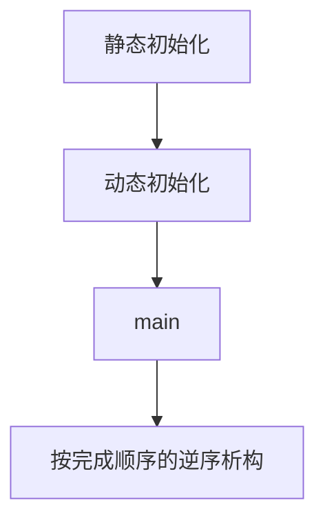

[TOC]

# 静态初始化顺序问题

命名空间作用域对象和静态数据成员，在同一翻译单元内按定义顺序做动态初始化；不同翻译单元之间，其中一个完整发生在另一个之前，哪个在前没有规定。初始化用到另一个翻译单元里尚未完成动态初始化的对象，就是静态初始化顺序问题。

## 概念

**静态初始化**：零初始化或常量初始化。全部静态初始化都发生在任何动态初始化之前。

> 常量初始化不读取其他对象的动态初始化结果。

```cpp
constexpr int n = 1; // 常量初始化
int m;               // 零初始化
```

**动态初始化**：静态初始化之外的初始化。同一翻译单元内，有序动态初始化按定义出现的顺序进行。以异常离开时调用 `std::terminate`。

> 是否在 `main` 第一条语句之前完成是实现定义。推迟时，发生在本翻译单元首次 ODR 使用之前。类内声明的先后不算，只看定义出现的位置。

```cpp
int f();
int n = f();   // 动态初始化
int m = n + 1; // 同一翻译单元内，n 先于 m
```

**静态初始化顺序问题**：不同翻译单元的有序动态初始化彼此不确定顺序。

> 标量在对方完成动态初始化前被读取，得到零初始化后的值。类类型在构造函数完成前被使用，是未定义行为。动态初始化期间若已启动主线程之外的线程，不同翻译单元的初始化可以无顺序，并发访问是未定义行为。

```cpp
// a.cpp
extern int value();
int g = value() + 1; // b.cpp 先完成则 g 为 43，否则 g 为 1

// b.cpp
int n = 42;
int value() { return n; }
```

## 对照

### 顺序

| 对比项 | 同一翻译单元 | 不同翻译单元 |
| --- | --- | --- |
| 有序动态初始化 | 按定义出现的顺序 | 不确定顺序 |
| 析构 | 初始化完成顺序的逆序 | 仍是完成顺序的逆序，完成顺序本身没有规定 |
| 初始化时使用另一个对象 | 只能依赖定义在前面的对象 | 不能假定对方已完成动态初始化 |

### 初始化阶段

| 对比项 | 静态初始化 | 动态初始化 |
| --- | --- | --- |
| 内容 | 零初始化或常量初始化 | 其余初始化 |
| 时机 | 任何动态初始化之前 | `main` 之前，或推迟到本翻译单元首次 ODR 使用 |
| 跨翻译单元 | 没有顺序问题 | 不确定顺序 |

### 标准版本

| 规则 | 标准 |
| --- | --- |
| 块作用域 `static` 的初始化只发生一次，并发进入时等待 | C++11 |
| 未显式特化的变量模板，动态初始化无序 | C++14 |
| `inline` 变量：它在每个翻译单元中的定义都位于另一对象之前时，先初始化 | C++17 |
| `constinit` 要求常量初始化，否则程序非法 | C++20 |

### 优缺点

| 做法 | 收益 | 代价 |
| --- | --- | --- |
| 同一翻译单元内按依赖顺序定义 | 顺序由标准规定，析构是其逆序 | 对象定义在其他翻译单元时无效 |
| 函数内 `static` | 首次调用时初始化，不参与跨翻译单元的动态初始化顺序 | 析构仍在程序退出时。初始化完成后的并发读写要另做同步 |
| `constexpr` 或 `constinit` | 常量初始化，不进入动态初始化 | 初始化式必须是常量表达式 |

## 流程

非局部对象在 `main` 返回后，按初始化完成的逆序析构。



## 示例

定义在前的对象可以被定义在后的对象使用。

```cpp
int n = 42;
int g = n + 1; // g 为 43
```

跨翻译单元的依赖改到首次调用时初始化。`value` 返回时，函数内的 `n` 已经完成初始化。

```cpp
int& value() {
    static int n = 42;
    return n;
}

int g = value() + 1; // g 为 43
```

## 易错点

1. 定义在后面的对象还没有做动态初始化。标量读到零初始化的值；编译器若把后面的初始化提前做成静态初始化，读到的值未指定。类类型在构造完成前被使用是未定义行为。
2. 类模板静态数据成员的实例化，以及 C++14 起未显式特化的变量模板，动态初始化无序，不按定义出现的顺序。显式特化仍是有序的。
3. 加上 `static` 或放进匿名命名空间只得到内部链接，不规定翻译单元之间的初始化顺序。
4. 函数内 `static` 只固定初始化时机。另一个静态对象的析构函数再使用它时，它可能已经析构。
5. 命名空间作用域的 `const int n = f();` 在 `f()` 不是常量表达式时仍是动态初始化。`const` 不消除顺序问题。

## 相关

- [static](./1.1.3-static关键字作用.md)
- [全局变量和局部变量](./1.1.6-全局变量和局部变量.md)
- [声明和定义](./1.1.4-变量的声明和定义.md)
