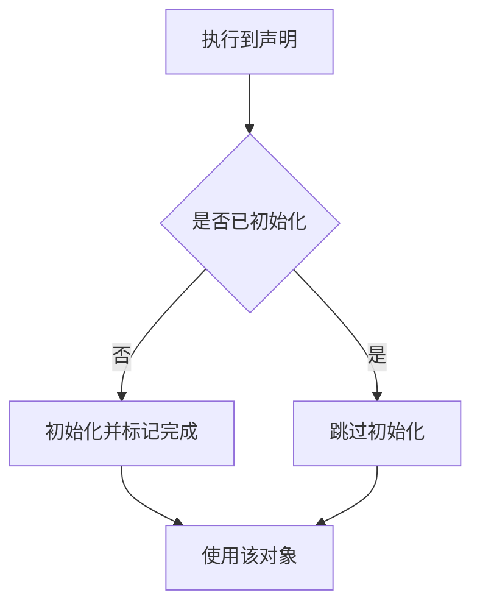

[TOC]

# static 关键字

`static` 指定静态存储期或内部链接。出现在类成员声明上时，该成员属于类，不属于某个对象。

## 概念

`static` 是存储类说明符。对象的存储在程序启动前分配，在程序终止时释放；命名空间作用域的 `static` 名字具有内部链接，其他翻译单元不能引用。

```cpp
void f() {
    static int n = 0; // 块作用域
}

static int g = 1; // 内部链接
static void h();  // 内部链接

struct A {
    static int s;     // 全类一个实体
    static void m();  // 没有隐式对象参数
};
int A::s = 0;         // 定义，此处不写 static
```

## 对照

### 语义

| 作用域 | 代码 | 存储期 | 存储位置 | 链接或访问 | 初始化 |
| --- | --- | --- | --- | --- | --- |
| 块作用域 | `void f() { static int n = 0; }` | 静态存储期 | 静态存储区，不在栈 | 无链接，只在该块可见 | 控制流第一次经过声明时初始化 |
| 命名空间作用域 | `static int g = 1;` | 静态存储期 | 静态存储区 | 内部链接 | 程序启动前 |
| 命名空间作用域 | `static void h();` | 无 | 代码段，无数据对象 | 内部链接 | 无 |
| 类作用域 | `struct A { static int s; };`<br>`int A::s = 0;` | 静态存储期 | 静态存储区，不在对象内 | `A::s` 或对象表达式 | 见下方标准版本 |
| 类作用域 | `struct A { static void m(); };` | 无 | 代码段，无数据对象 | `A::m()` 或对象表达式 | 无 `this`，不能直接访问非静态成员 |

非零初值位于数据段 `.data`，只做零初始化的位于 `.bss`。动态初始化只决定写入时机，不改变这块存储的位置。

> C++ 没有文件作用域。static void h(); 同样在命名空间作用域；文件作用域是 C 的术语

### C 与 C++

C 的 `static` 是存储类说明符，只用在块作用域和文件作用域。块作用域对象具有静态存储期、无链接；文件作用域的对象和函数具有内部链接。

```c
void f(void) {
    static int n = 0; /* 静态存储期。初值是常量表达式，程序启动前写入 */
}

static int g = 1;    /* 文件作用域，内部链接，静态存储期 */
static void h(void); /* 文件作用域，内部链接 */

void read(int a[static 10]); /* C99：a 指向的数组至少有 10 个 int */
```

`n` 的存储不在栈上，函数多次调用之间保留上次的值。

| 对比项 | C | C++ |
| --- | --- | --- |
| 块作用域对象 | `static int n = 0;` 静态存储期，无链接 | 有。语义相同 |
| 块作用域初值 | 常量表达式，程序启动前初始化 | 可以用非常量。控制流第一次经过声明时初始化 |
| 文件作用域对象 | `static int g = 1;` 内部链接，静态存储期 | 有。该作用域称为命名空间作用域 |
| 文件作用域函数 | `static void h(void);` 内部链接 | 有 |
| 不加 `static` 的文件作用域变量 | 仍是静态存储期，默认外部链接 | 仍是静态存储期，默认外部链接 |
| 类成员 | 无 | 有 |
| 参数数组中的 `static` | C99：`int a[static 10]`，要求至少 10 个元素 | 标准无此语法 |
| 内部链接的另一种写法 | 无 | 匿名命名空间 |

### 标准版本

| 规则 | 标准 |
| --- | --- |
| 块作用域 `static` 的动态初始化只发生一次，并发进入时等待 | C++11 |
| 类内 `inline static` 成员的声明就是定义 | C++17 |
| `static constexpr` 数据成员隐含 `inline` | C++17 |

### 优缺点

| 用法 | 收益 | 代价 |
| --- | --- | --- |
| 块作用域 `static` | 调用之间保留状态，动态初始化只发生一次 | 隐藏状态。初始化之后的并发读写仍要同步 |
| 内部链接 | 名字不参与其他翻译单元的符号解析 | 每个翻译单元各有一份 |
| 静态数据成员 | 所有对象共享同一实体 | 要有唯一定义。不同翻译单元之间的动态初始化顺序未指定 |
| 静态成员函数 | 调用不需要对象 | 没有隐式对象参数 |

## 流程

C++ 里，块作用域 `static` 的动态初始化发生在控制流第一次经过它的声明时。



## 示例

块作用域
```cpp
int next() {
    static int n = 0;
    return ++n;
}
// 依次调用的结果是 1、2、3
```

## 易错点

1. 命名空间作用域的变量不加 `static` 也具有静态存储期，默认是外部链接。
2. 块作用域 `static` 只保证初始化过程的并发安全。初始化完成后的读写要由调用者同步。
3. 静态数据成员被使用却没有唯一定义时，链接失败。
4. C++17 之前，类内的 `static const int n = 1;` 一旦被取地址，仍要在类外提供定义。

## 相关

- [全局变量和局部变量](./1.1.6-全局变量和局部变量.md)
- [声明和定义](./1.1.4-变量的声明和定义.md)
- [静态初始化顺序](./1.1.13-静态初始化顺序问题.md)
- [静态初始化顺序](./1.1.13-静态初始化顺序问题.md)
