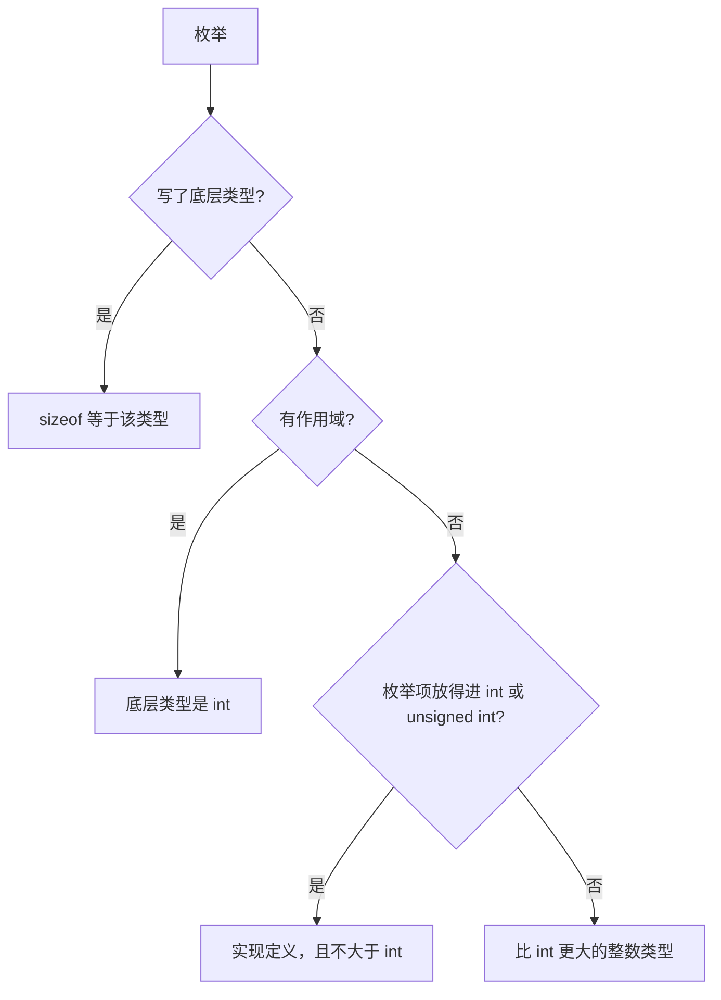

[TOC]

# 枚举大小

`sizeof` 枚举等于 `sizeof` 它的底层类型。有作用域枚举不写底层类型时，底层类型是 `int`。无作用域枚举不写底层类型时，实现选择一个能放下全部枚举项的整数类型，并且不得大于 `int`，除非有枚举项放不进 `int` 和 `unsigned int`。

## 概念

**底层类型**：枚举值实际存储用的整数类型。枚举的大小和对齐与这个类型相同。

```cpp
enum class Color : std::uint8_t { red, green };
// sizeof(Color) == 1
// sizeof(Color) == sizeof(std::underlying_type<Color>::type)
```

**有作用域枚举**：`enum class` 或 `enum struct`。未指定底层类型时，底层类型固定为 `int`。

> ILP32、LP64、LLP64 上 `int` 都是 4 字节，因此 `sizeof` 为 4。

```cpp
enum class Color { red, green };
// sizeof(Color) == sizeof(int)
```

**无作用域枚举**：`enum`。未指定底层类型时，底层类型是实现定义的。

> 枚举项列表为空时，按存在一个值为 0 的枚举项处理。出现负值时，底层类型是有符号整数。

```cpp
enum Channel { left, right };
// 值能放进 int 时，常见 sizeof 为 4
```

**固定底层类型**：声明中写 `: 整数类型`。大小由该类型决定。这样声明之后，枚举类型就是完整的。

```cpp
enum class Color;            // sizeof == sizeof(int)
enum Channel : std::uint8_t; // sizeof == 1
```

## 对照

### 语义

| 对比项 | 无作用域，未指定底层类型 | 有作用域，未指定底层类型 | 指定了底层类型 |
| --- | --- | --- | --- |
| 写法 | `enum E { a }` | `enum class E { a }` | `enum E : std::uint8_t { a }` |
| 底层类型 | 实现定义 | `int` | 冒号后的类型 |
| 值都放得进 `int` 时的常见大小 | 4 | 4 | `sizeof` 该类型 |
| 前向声明 | 非法 | `enum class E;` 合法 | `enum E : int;` 合法 |

### 编译器

只针对未指定底层类型的无作用域枚举。值都能放进 `int`。

| 实现 | 大小 |
| --- | --- |
| GCC、Clang 默认 | `int`，4 字节 |
| GCC、Clang `-fshort-enums` | 能容纳全部枚举项的最小整数类型，可以是 1 或 2 字节 |
| MSVC | `int`，4 字节 |

> 有作用域枚举和已经指定底层类型的枚举不受 `-fshort-enums` 影响。

### 标准版本

| 规则 | 标准 |
| --- | --- |
| 可指定底层类型；`enum class` 的默认底层类型是 `int` | C++11 |
| `std::underlying_type` | C++11 |
| `std::underlying_type_t` | C++14 |
| C 可写 `enum E : int` | C23 |

### C 与 C++

| 对比项 | C（C23 之前） | C++ |
| --- | --- | --- |
| 有作用域枚举 | 无 | `enum class`，默认大小为 `sizeof(int)` |
| 指定底层类型 | 无 | C++11 起可以，大小等于该类型 |
| 未指定时的大小 | 实现定义，常见为 `sizeof(int)` | 无作用域枚举仍是实现定义 |

## 流程

大小先看有没有写底层类型，再看是不是有作用域枚举。



## 示例

放得进 `unsigned int` 的值不会把枚举撑过 4 字节。放不进 `int` 和 `unsigned int` 时，LP64 和 LLP64 上都要 64 位，`sizeof` 为 8。

```cpp
enum Wide { n = 0xFFFFFFFFu };
// sizeof(Wide) == 4

enum Big { n = 1LL << 40 };
// sizeof(Big) == 8
```

## 易错点

1. `enum class` 不写底层类型时，大小是 `sizeof(int)`。主流平台上是 4，不会因为枚举项只有两个就变成 1。
2. 无作用域枚举的默认大小是实现定义。GCC、Clang 打开 `-fshort-enums` 后，小值域可能变成 1 或 2 字节。
3. 枚举项只要能放进 `int` 或 `unsigned int`，底层类型就不得大于 `int`。`0xFFFFFFFFu` 的 `sizeof` 仍是 4。
4. `enum E;` 这种未指定底层类型的前向声明是非法的，大小无法确定。
5. 位域占用的是位域宽度。`enum E { a, b }; struct S { E e : 2; };` 里 `e` 占 2 位，不是 `sizeof(E)`。

## 建议

- 大小要在编译器之间保持一致时，写出底层类型，例如 `enum class Color : std::uint8_t`。
- 对象很多、值域不超过 255 时，用 `std::uint8_t`；不超过 65535 时，用 `std::uint16_t`。
- 和无作用域枚举的 C 接口交互时，写成 `enum E : int`，避免 `-fshort-enums` 改变布局。

## 相关

- [常用数据类型大小](../1.8-数据类型/1.8.1-常用数据类型大小.md)
