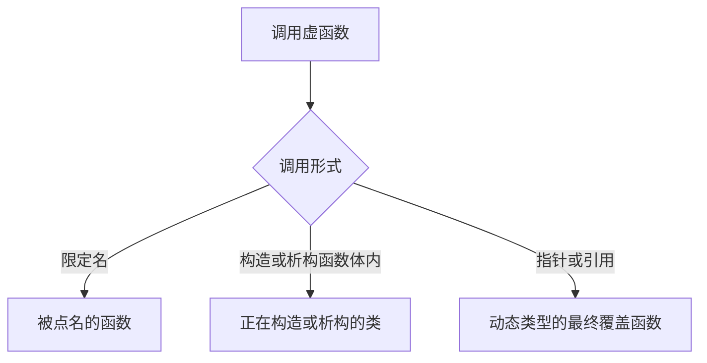

[TOC]

# 虚函数

`virtual` 声明的非静态成员函数是虚函数。通过基类指针或引用调用时，执行动态类型中的最终覆盖函数。

## 概念

**虚函数**：非静态成员函数，声明带 `virtual`。调用时按对象的动态类型选择最终覆盖函数。

> 动态类型在编译期已知时，实现可以改成直接调用，选定的函数不变。常见实现给对象增加一个虚表指针。

```cpp
struct Base {
    virtual void f();
    void g();
};
struct Derived : Base {
    void f() override;
};

Base* p = new Derived;
p->f(); // Derived::f
p->g(); // Base::g
```

**覆盖**：派生类函数与基类虚函数名字相同，参数类型、cv 限定和引用限定相同。该函数成为最终覆盖函数。

> 返回指针或引用时，类型可以是派生类的指针或引用。写出 `override` 后若不构成覆盖，程序非法。

```cpp
struct Base {
    virtual Base* clone();
};
struct Derived : Base {
    Derived* clone() override;
};
```

**隐藏**：派生类声明一个名字之后，基类里这个名字的其余声明在派生类作用域中不可见。

> `using Base::f;` 把这些声明重新引入派生类。

```cpp
struct Base {
    virtual void f(int);
    virtual void f(const char*);
};
struct Derived : Base {
    void f(int) override;
};
// Derived d; d.f("a"); 编译失败
```

**纯虚函数**：以 `= 0` 结束的虚函数。所在类是抽象类，不能创建该类型的对象。

> 纯虚函数可以有函数体，通过限定名调用。派生类覆盖之后才能创建派生类对象。

```cpp
struct Base {
    virtual void f() = 0;
};
// Base b; 非法
```

**虚析构函数**：基类析构函数为虚函数时，`delete` 基类指针会调用动态类型的析构函数。

> 派生类析构函数覆盖基类的虚析构函数，名字不必相同。

```cpp
struct Base {
    virtual ~Base() {}
};
struct Derived : Base {};

Base* p = new Derived;
delete p; // ~Derived，然后 ~Base
```

**`final`**：标在虚函数上时，该函数不能再被覆盖。标在类上时，该类不能再被继承。

```cpp
struct Base {
    virtual void f() final;
};
struct Last final : Base {};
```

## 对照

### 语义

| 对比项 | 虚函数 | 非虚函数 |
| --- | --- | --- |
| 基类指针或引用上的调用 | 动态类型的最终覆盖函数 | 静态类型中的函数 |
| 派生类的同签名函数 | 覆盖 | 隐藏 |
| 派生类再次声明时省略 `virtual` | 仍是虚函数 | 无 |
| 经基类指针 `delete` | 先执行派生类析构函数 | 未定义行为 |

### 优缺点

| 做法 | 收益 | 代价 |
| --- | --- | --- |
| 虚函数 | 同一调用点随动态类型选择函数 | 动态类型未知时是间接调用，不能内联 |
| 非虚函数 | 调用目标在编译期确定 | 基类指针或引用上调用不到派生类版本 |

### 标准版本

| 规则 | 标准 |
| --- | --- |
| `override`、`final` | C++11 |
| 虚函数可以是 `constexpr` | C++20 |

## 流程

限定名调用被点名的函数。构造函数和析构函数体内的虚调用，绑定到正在构造或析构的类。



## 结构

虚函数表是实现手段。一类一张表，表放在只读数据中，具有静态存储期。每个多态对象保存指向这张表的指针，指针占一个指针的宽度。成员函数的机器码在代码段。

`Derived` 覆盖 `f` 后，对应槽换成 `Derived::f`；没有覆盖的 `h` 仍指向 `Base::h`。派生类新声明的虚函数追加在表尾。非虚函数没有槽。纯虚函数先占一个槽，里面是实现提供的出错处理入口，覆盖之后换成覆盖函数。

```cpp
struct Base {
    int n;
    virtual void f();
    virtual void h();
    void g();
};
struct Derived : Base {
    int m;
    void f() override;
};
```

`Base` 子对象在前，虚表指针在该子对象的起始处。同一类的各个对象各有各的指针，指向同一张表。

```text
Derived 对象                    Derived 的虚函数表
+----------------+              +----------------+
| vptr           | -----------> | Derived::f     |
+----------------+              +----------------+
| int n          |              | Base::h        |
+----------------+              +----------------+
| int m          |
+----------------+

Base 对象                       Base 的虚函数表
+----------------+              +----------------+
| vptr           | -----------> | Base::f        |
+----------------+              +----------------+
| int n          |              | Base::h        |
+----------------+              +----------------+
```

构造一个子对象时，实现把该子对象的虚表指针指向正在构造的类的虚表。整个对象构造完成后，指针指向最终派生类的虚表。虚表旁还有运行时类型信息，供 `typeid` 和 `dynamic_cast` 使用。

多继承时，每个含虚函数的基类子对象各有一个虚表指针。转换成第二个基类指针时，地址加上该子对象的偏移；这个子对象的表项在调用前把 `this` 调回完整对象。

```cpp
struct B1 { int a; virtual void f(); };
struct B2 { int b; virtual void g(); };
struct D : B1, B2 {
    int c;
    void f() override;
    void g() override;
};
```

```text
D 对象
+----------------+
| vptr（B1）     | --> D 相对 B1 的虚表：D::f
| int a          |
+----------------+
| vptr（B2）     | --> D 相对 B2 的虚表：D::g
| int b          |
+----------------+
| int c          |
+----------------+
```

> 虚继承还要记录虚基类的偏移。GCC、Clang 把偏移放在虚表里，MSVC 使用单独的虚基类表指针。

## 示例

切片之后动态类型是基类。限定名不看动态类型。

```cpp
struct Base {
    virtual void f() {}
};
struct Derived : Base {
    void f() override {}
};

Derived d;
Base b = d;
b.f(); // Base::f

Base* p = &d;
p->Base::f(); // Base::f
p->f();       // Derived::f
```

默认实参取静态类型的声明。

```cpp
struct Base {
    virtual void f(int n = 1) {}
};
struct Derived : Base {
    void f(int n = 2) override {}
};

Base* p = new Derived;
p->f(); // Derived::f，n 为 1
```

构造基类子对象时，虚调用进入基类版本。

```cpp
struct Base {
    Base() { f(); }
    virtual void f() {}
};
struct Derived : Base {
    Derived() {}
    void f() override {}
};
// Derived d; 执行 Base::Base 时调用 Base::f
```

访问检查看静态类型。

```cpp
struct Base {
    virtual void f() {}
};
struct Derived : Base {
private:
    void f() override {}
};

Base* p = new Derived;
p->f(); // Derived::f
```

## 易错点

1. 参数类型、cv 限定或引用限定有一处不同，就不构成覆盖，并隐藏基类中的同名声明。
2. 构造函数和析构函数执行期间，虚调用绑定到正在构造或析构的类。
3. 默认实参取静态类型的声明，不取最终覆盖函数的默认实参。
4. 构造函数和静态成员函数不能声明为 `virtual`。
5. 访问检查看静态类型。最终覆盖函数是 private 时仍会被调用。

## 相关

- [多态的实现](./1.5.3-多态的实现.md)
- [重写和覆盖](./1.5.1-重写和覆盖的区别.md)
- [纯虚函数](./1.5.6-纯虚函数作用.md)
- [虚函数表](./1.5.7-虚函数表.md)
- [多继承](./1.5.9-多继承相关.md)
- [虚继承](./1.5.10-虚继承.md)
- [构造和析构函数](./1.5.4-构造和析构函数.md)
- [类型转换](../1.8-数据类型/1.8.3-类型转换.md)
