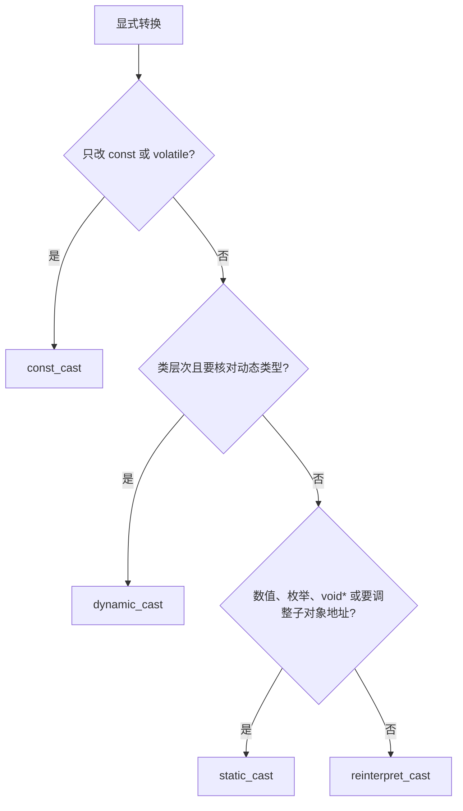

[TOC]

# 类型转换

具名转换把关系写在运算符里。`static_cast` 转换编译期能够确定的相关类型，`const_cast` 只改 `const` 或 `volatile`，`dynamic_cast` 按动态类型做类层次转换，`reinterpret_cast` 把指针当作另一种指针类型。C 风格转换在 `const_cast`、`static_cast`、`reinterpret_cast` 中按顺序选用。

## 概念

**C 风格转换**：记法 `(T)expr`。编译器按候选顺序采用第一种合法转换。

> 标量类型的函数式记法 `T(expr)` 使用同一组规则。私有基类的指针转换，具名 `static_cast` 会因不可访问而失败，C 风格转换仍然可以完成。

```cpp
int n = 65;
char c = (char)n; // 相当于 static_cast<char>(n)

const int* p = &n;
double* d = (double*)p; // reinterpret_cast 之后再去掉 const
```

**`static_cast`**：编译期完成的相关类型转换。包括数值、枚举、`void*` 与对象指针，以及类层次中要调整到子对象的指针。

> 向下转换能通过编译。对象的动态类型不是目标类型时，使用结果是未定义行为。

```cpp
// 1. 基本类型转换
double d = 3.14;
int i = static_cast<int>(d);          // 3

// 2. 枚举与整数
enum class Color { Red, Green };
int v = static_cast<int>(Color::Green);

// 3. void* 转回原类型
void* p = &i;
int* ip = static_cast<int*>(p);

// 4. 继承体系中的上行转换（子类 -> 父类），安全
Derived d1;
Base* b = static_cast<Base*>(&d1);

// 5. 下行转换（父类 -> 子类），不做运行期检查，不安全
Derived* dp = static_cast<Derived*>(b);   // 你得自己保证 b 真的指向 Derived
```

**`const_cast`**：增减 `const` 或 `volatile`。去掉限定后的类型必须与原类型相同。

> 对象的定义带 `const` 时，去掉限定再写入，是未定义行为。

```cpp
int n = 1;
const int* p = &n;
int* q = const_cast<int*>(p);
*q = 2; // n 的定义没有 const
```

**`dynamic_cast`**：沿类层次转换指针或引用，并核对完整对象的动态类型。

> 向上转换可以没有虚函数。向下转换和交叉转换要求源类型是多态类，否则程序非法。指针失败得到空指针；引用失败抛出 `std::bad_cast`。

```cpp
struct Base { virtual ~Base() {} };
struct Derived : Base {};

Base* ok = new Derived;
Derived* d = dynamic_cast<Derived*>(ok); // 指向该 Derived

Base* only = new Base;
Derived* miss = dynamic_cast<Derived*>(only); // nullptr
```

**`reinterpret_cast`**：把对象指针当作另一种对象指针，或在指针与足够宽的整数之间转换。

> 目标类型的对齐要求不更严时，地址保持不变。指针和整数的对应是实现定义。用无关类型读取对象是未定义行为，`char`、`unsigned char`、`std::byte` 可以检查对象表示。函数指针之间的转换是条件支持。

```cpp
int n = 1;
char* bytes = reinterpret_cast<char*>(&n);
std::intptr_t addr = reinterpret_cast<std::intptr_t>(&n);
```

## 对照

### 检查时机

| 转换 | 检查时机 | 主要用途 | 举例 |
| --- | --- | --- | --- |
| `static_cast` | 编译期 | 相关类型之间的转换 | `static_cast<int>(1.9)` 得到 `1` |
| `dynamic_cast` | 运行期 | 多态类型的向下转换 | `dynamic_cast<Derived*>(p)`，失败得到 `nullptr` |
| `const_cast` | 编译期 | 增减 `const` 或 `volatile` | `const_cast<int*>(p)` 去掉 `const` |
| `reinterpret_cast` | 编译期 | 用另一种指针类型查看同一地址 | `reinterpret_cast<char*>(&n)` 查看对象表示 |

### 语义
| 对比项 | `static_cast` | `const_cast` | `dynamic_cast` | `reinterpret_cast` |
| --- | --- | --- | --- | --- |
| 数值、枚举 | 可以 | 非法 | 非法 | 非法 |
| 去掉 `const` | 非法 | 可以 | 非法 | 非法 |
| 类层次中的指针 | 调整到目标子对象 | 非法 | 调整到目标子对象 | 地址不变 |
| 动态类型不符的向下转换 | 未定义行为 | 非法 | 指针为空指针 | 地址不变 |
| 无关对象指针 | 非法 | 非法 | 非法 | 可以 |
| `void*` 转到对象指针 | 可以 | 非法 | 非法 | 可以 |

### 搜索顺序

C 风格转换按这张表从上到下采用第一种合法转换。

| 顺序 | 采用的转换 |
| --- | --- |
| 1 | `const_cast` |
| 2 | `static_cast` |
| 3 | `static_cast` 之后再 `const_cast` |
| 4 | `reinterpret_cast` |
| 5 | `reinterpret_cast` 之后再 `const_cast` |

### 优缺点

| 做法 | 收益 | 代价 |
| --- | --- | --- |
| `static_cast` | 只接受相关类型 | 向下转换不核对动态类型 |
| `const_cast` | 只改 cv 限定 | 写入真正的 const 对象是未定义行为 |
| `dynamic_cast` | 失败可以检测 | 向下和交叉转换需要多态类与运行时类型信息 |
| `reinterpret_cast` | 能保持地址并更换指针类型 | 按错误类型访问对象是未定义行为 |
| C 风格转换 | 一种记法覆盖多组转换 | 看不出实际采用了哪一种 |

### 标准版本

| 规则 | 标准 |
| --- | --- |
| 四种具名转换 | C++98 |
| `std::byte` 可以别名访问对象表示 | C++17 |
| `std::bit_cast` 在两个同大小、可平凡复制的类型之间复制对象表示 | C++20 |

## 流程

显式转换先看改的是 cv 限定、类层次，还是指针的地址解释。



## 示例

`static_cast` 向下转换不看动态类型。

```cpp
struct Base { int n = 0; };
struct Derived : Base { int m = 1; };

Base b;
Derived* p = static_cast<Derived*>(&b); // 使用 p 是未定义行为
```

`dynamic_cast` 可以把一个基类指针转到另一个基类。引用失败时抛出异常。

```cpp
struct B1 { virtual ~B1() {} };
struct B2 { int n = 0; };
struct D : B1, B2 {};

B1* p = new D;
B2* q = dynamic_cast<B2*>(p); // 指向 D 中的 B2 子对象

B1 b;
D& r = dynamic_cast<D&>(b); // 抛出 std::bad_cast
```

类外部把派生类转成私有基类时，C 风格转换可以完成。

```cpp
struct Base {};
struct Derived : private Base {};

Derived d;
Base* p = (Base*)&d; // 转到不可访问的基类
```

## 易错点

1. `static_cast` 的向下转换编译能通过。动态类型不是目标类型时，使用转换结果是未定义行为。
2. `const_cast` 之后修改定义时带 `const` 的对象，是未定义行为。
3. `dynamic_cast` 转到指针失败得到空指针，转到引用失败抛出 `std::bad_cast`。源类型没有虚函数时，向下转换程序非法。
4. `reinterpret_cast` 不能去掉 `const`。多继承时它不调整基类子对象的地址。
5. C 风格转换的候选里没有 `dynamic_cast`。一次转换可以同时更换指针类型并去掉 `const`。

## 建议

不用c的强制转化，用c++的类型转化，是因为(T)x 会依次尝试 const_cast、static_cast、reinterpret_cast 等，悄悄选一个能成功的，你看不出到底做了哪种转换，也无法 grep 搜索。

## 相关

- [虚函数](../1.5-面向对象/1.5.13-虚函数.md)
- [long 和 long long](./1.8.2-long和longlong.md)
