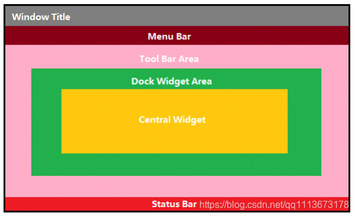

@[TOC](文章目录)

<hr style=" border:solid; width:100px; height:1px;" color=#000000 size=1">

# 前言
QAction是QMenu的一个选项，代表了窗口的一个动作。

# MainWindows
继承QMainWindows 基本窗体
基本结构


## 菜单栏、工具栏和状态栏

一个窗口只有一个菜单栏，但是却可能有多个工具栏。

工具栏可以设置成固定的、浮动的等等

使用`QAction::setStatusTip()`可以设置该动作在状态栏上的提示文本。

QToolBar以及QStatusBar都是QWidget的子类，因此我们就可以将其结合布局管理器添加到另外的QWidget上面。QLayout布局提供了setMenuBar()函数，可以方便的添加菜单栏。具体细节还是详见文档。
# qmake
类似cmake 项目构建工具  对源代码，依赖库的添加，编译可执行还是库文件等的配置

# 添加动作

> 本节，我们将在前面主窗口基础之上，添加菜单和工具栏等的动作。虽然 Qt Creator
> 已经帮我们实现了主窗口的框架代码，但是具体的功能，还是需要我们一行行添加。

什么是动作？它的作用是？
> Qt
> 使用QAction类作为动作。顾名思义，这个类就是代表了窗口的一个“动作”，这个动作可能显示在菜单，作为一个菜单项，当用户点击该菜单项，对用户的点击做出响应；也可能在工具栏，作为一个工具栏按钮，用户点击这个按钮就可以执行相应的操作。有一点值得注意：无论是出现在菜单栏还是工具栏，用户选择之后，所执行的动作应该都是一样的。

>因此，Qt并没有专门的菜单项类，只是使用一个QAction类，抽象出公共的动作。当我们把QAction对象添加到菜单，就显示成一个菜单项，添加到工具栏，就显示成一个工具按钮。用户可以通过点击菜单项、点击工具栏按钮、点击快捷键来激活这个动作。


> QAction包含了图标、菜单文字、快捷键、状态栏文字、浮动帮助等信息。当把一个QAction对象添加到程序中时，Qt自己选择使用哪个属性来显示，无需我们关心。

> 同时，Qt能够保证把QAction对象添加到不同的菜单、工具栏时，显示内容是同步的。也就是说，如果我们在菜单中修改了QAction的图标，那么在工具栏上面这个QAction所对应的按钮的图标也会同步修改。


```cpp
//////////////////////mainwindow.h
#ifndef MAINWINDOW_H
#define MAINWINDOW_H

#include <QMainWindow>

QT_BEGIN_NAMESPACE
namespace Ui { class MainWindow; }
QT_END_NAMESPACE

class MainWindow : public QMainWindow
{
    Q_OBJECT

public:
    MainWindow(QWidget *parent = nullptr);
    ~MainWindow();

private:
    Ui::MainWindow *ui;

    void open();
    QAction *openAction;
};
#endif // MAINWINDOW_H


//////////////////////mainwindow.cpp
#include "mainwindow.h"
#include "ui_mainwindow.h"

#include <QAction>
#include <QMenuBar>
#include <QMessageBox>
#include <QStatusBar>
#include <QToolBar>


MainWindow::MainWindow(QWidget *parent)
    : QMainWindow(parent)
    , ui(new Ui::MainWindow)
{
    setWindowTitle(tr("Main Window"));//设置标题

    openAction = new QAction(QIcon(":/images/doc-open"), tr("&Open..."), this); //创建动作 图标 文字 Qobject
    openAction->setShortcuts(QKeySequence::Open);//设置快捷键  QKeySequence::Open 代表Ctrl+O  QKeySequence类来添加快捷键，会根据平台的不同来定义相应的快捷键。
    openAction->setStatusTip(tr("Open an existing file"));//设置鼠标滑过提示
    connect(openAction, &QAction::triggered, this, &MainWindow::open);//连接信号槽 openAction triggered时 触发主窗口打开open动作

    QMenu *file = menuBar()->addMenu(tr("&File")); //添加菜单栏 菜单File
    file->addAction(openAction);//菜单栏 添加动作

    QToolBar *toolBar = addToolBar(tr("&File"));//添加工具栏 工具File
    toolBar->addAction(openAction);//工具栏添加 动作file

    statusBar();//底部边栏 显示提示信息 statusTip
}

MainWindow::~MainWindow()
{
    delete ui;
}

void MainWindow::open()
{
    QMessageBox::information(this, tr("Information"), tr("Open"));//打开提示MessageBox
}

/////////////////////////main.cpp

#include "mainwindow.h"

#include <QApplication>

int main(int argc, char *argv[])
{
    QApplication a(argc, argv);
    MainWindow w;
    w.show();
    return a.exec();
}

```


具体解释参考代码注释

## tips

 - 使用 menu,//菜单栏
          toolbar,//工具栏
          statusBar,//底部状态栏
          messageBox,//消息对话框
          qaction,//动作事件
          
- QAction第二个参数中，文本值前面有一个 &，意味着这将成为一个快捷键。注意看截图中 File 的 F 有一个下划线。

 - ** tr() **  这是一个用于 Qt 国际化的函数。在后续章节中我们可以看到，我们可以使用 Qt 提供的国际化工具，将tr()函数的字符串提取出来，进行国际化。由于所需进行国际化的文本应该被大多数人认识，所以，tr()函数里面一般会是英文文本。
 - **setShortcuts() 设置快捷键   QKeySequence 常用快捷键集合**
 - **添加资源图片文件qrc**

	add new--Qt--Qt Resource File   
	resource.qrc
	如下 意味着使用逻辑路径 /images/doc-open 映射着./images/open_document.png 物理路径
	```css
	<!DOCTYPE RCC>
	<RCC version="1.0">
	    <qresource prefix="/images">
	        <file alias="doc-open">./images/open_document.png</file>
	    </qresource>
	</RCC>
	```
	当我们编译工程之后，我们可以在构建目录中找到 qrc_resource.cpp 文件，这就是 Qt 将我们的资源编译成了 C++ 代码。

 