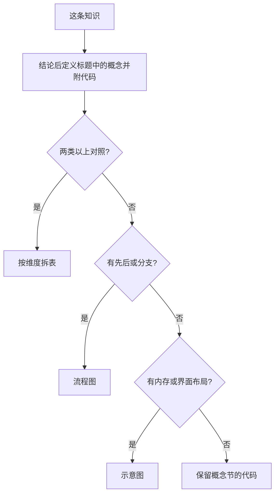

[TOC]

# 面试知识点文档规范

一篇笔记只回答一个问题。结论之后介绍标题中的概念，并用代码、表格、图表展开。三者都优先于文字。

## 原则

| 要求 | 做法 |
| --- | --- |
| 专有名词 | 用链接、存储期、未定义行为、时间复杂度等计算机术语，不用口语代替 |
| 先结论，再概念 | 标题里的每个概念，在结论后按 **术语**：解释 分层，并给出代码 |
| 文字突出 | 术语用 `**`，名字和代码用 `` ` ``，边界和例外用 `>` |
| 多重对照 | 基本对照语义、优缺点，涉及编译器、存储器、平台、标准版本等再补充维度，一类对照一张表 |
| 代码优先 | 接口、布局、结果用代码说明。改造旧文时，删掉就说不清的代码必须保留 |
| 少文字 | 代码、表格、图表装得下的事实，不写成段落 |
| 结构固定 | 一级标题一个。二级标题按骨架顺序取用，空节不留 |

## 骨架

| 顺序 | 标题 | 放什么 |
| --- | --- | --- |
| 1 | 标题 | 知识点名称，用名词 |
| 2 | 结论或解释问题原因和本质或简介本篇内容 | 一两句，或一行两列表 |
| 3 | 概念 | **术语**：解释，分层；例外用引用；附代码 |
| 4 | 对照 | 一张表一个维度，需要时连续多张 |
| 5 | 流程 / 结构 | Mermaid 或示意图 |
| 6 | 示例 | 概念节没覆盖的调用、边界、输出 |
| 7 | 易错点 | 编号列表，不超过 5 条 |
| 8 | 建议 | 使用时的建议|
| 9 | 相关 | 相对链接 |

~~~~markdown
[TOC]

# 标题

一句话结论。

## 概念

**声明**：引入名字和类型，不分配存储。

> 可以多次出现，各处类型必须一致。

**定义**：为对象分配存储的声明。

```cpp
extern int n;
int n = 1;
```

## 对照

| 对比项 | A | B |
| --- | --- | --- |
|  |  |  |

## 易错点

1.
~~~~

## 概念

标题里的术语在结论后介绍。一个术语一层，写成 **术语**：解释，不合并成段落。紧跟最短代码。

**声明**：引入名字并给出类型。

> 不分配存储。同一实体可以多次声明。

```cpp
extern int n;
```

| 层 | 写法 | 放什么 |
| --- | --- | --- |
| 第一层 | `**术语**：解释` | 这个概念是什么 |
| 第二层 | `>` 引用 | 边界、例外、易混的一句 |
| 代码 | 围栏代码块，语言标记 `cpp` | 能区分该术语的最短写法 |

| 概念里保留的代码 | 例子 |
| --- | --- |
| 声明、签名 | `void *memcpy(void *dst, const void *src, size_t n);` |
| 能区分含义的写法 | `const int *p` 与 `int * const p` |
| 原笔记已有、且仍是最短证据的片段 | 改造时原样留下，只删无关的 `main` 和输出 |

一层只解释一个术语。代码已经表达的事实，后面的表格不重复抄写。

## 突出

| 标记 | 用于 | 不用于 |
| --- | --- | --- |
| `` `名字` `` | 类型、关键字、函数、代码片段 | 整句解释 |
| `**术语**` | 分层标题，后面接全角冒号和解释 | 整段加粗 |
| `>` | 边界、例外、补充的一句 | 代替表格或代码 |

## 对照

一类差异一张表。没有差异的维度不单列。

| 维度 | 何时单独成表 | 表头示例 |
| --- | --- | --- |
| 语义 / 接口 | 行为、参数、返回值不同 | `memcpy` / `memmove` |
| 优缺点 | 存在取舍 | 省调用开销 / 代码体积 |
| 编译器 | GCC、Clang、MSVC 结果不同 | `long double` 的大小 |
| 平台 / 数据模型 | LP64、LLP64、ILP32 不同 | `long`、指针 |
| 标准版本 | C++11、C++14、C++17、C++20 规则不同 | `constexpr` 函数体 |
| 复杂度 | 时间或空间不同 | `O(1)`、`O(log n)` |

| 规则 | 说明 |
| --- | --- |
| 第一列 | 对比项，用名词 |
| 表头 | 被比较的对象、编译器或数据模型 |
| 单元格 | 短语或数字。一个单元格一件事 |
| 空单元格 | 写「无」或具体事实，不留空 |

## 用哪种形式



| 内容 | 形式 |
| --- | --- |
| 术语的含义 | 概念节的定义 + 代码 |
| 类型、容器、编译器、平台、标准版本、优缺点 | 分表，第一列是对比项 |
| 调用顺序、状态迁移、排查分支 | Mermaid |
| 内存布局、界面、实验结果 | 图片，图注写图中的内容 |
| 语法、接口、边界值 | 代码块，只留相关行 |
| 例外 | 编号列表，如移位量、有符号溢出 |

同一事实只用一种形式。

## 代码

| 场合 | 要求 |
| --- | --- |
| 介绍概念 | 必须有能说明该概念的代码 |
| 改造旧文 | 保留签名、关键语句、输出结果。删重复包含、空行、与结论无关的打印 |
| 语言标记 | 写 `cpp`。伪布局用 `text` |
| 长度 | 只留能删就不能说明问题的行 |

## 术语

| 不写 | 写成 |
| --- | --- |
| 别的文件看不见 | 内部链接 |
| 程序从启动到结束都在 | 静态存储期，或静态存储区 |
| 结果说不准 | 未定义行为 |
| 编译器自己选，文档里有说明 | 实现定义 |
| 多个源文件各定义一次会冲突 | 违反单一定义规则 |
| 快慢 | 时间复杂度，写成 `O(1)`、`O(log n)` |
| 类型、函数、关键字 | 放进反引号 |

句子陈述事实。结论放在节首。概念解释按 **术语**：解释 分行，不写成段落。

## 图

| 种类 | 写法 |
| --- | --- |
| 流程、状态、分支 | Mermaid，节点用短词 |
| 截图、内存图、界面 | `` |
| 存放 | `images/` 下按文档目录对应放置 |

图注写图里有什么。图周围用一句给出读图结论。

## 文件

| 项 | 要求 |
| --- | --- |
| 范围 | 一文件一题 |
| 文件名 | 与一级标题对应，沿用所在目录的编号 |
| 目录 | 较长笔记文首加 `[TOC]` |
| 标题层级 | `#` 一个，正文从 `##` 开始，不跳级 |
| 链接 | 相关笔记用相对路径，链到具体文件 |
